# EG1 Web Portal (`eg1.in`)

Modern, high-performance web portal and application catalog for [EG1](https://eg1.in), built with **React 18**, **TypeScript**, and **Vite**, powered by the generic and website-agnostic [`eg-web-core`](https://github.com/EG1DOTIN/eg-web-core) library.

---

## 🏗️ Architecture & Component Flow

```mermaid
flowchart TD
    subgraph Browser["Client Browser & Routing Engine"]
        Router["App.tsx (SPA Path Normalizer)"]
        History["PopState & pushState Listener"]
        Router <--> History
    end

    subgraph Pages["Portal Page Modules (src/pages/)"]
        Home["HomePage.tsx (Hero Slider, Catalog & Updates)"]
        Apps["AppsPage.tsx (Apps Catalog & Specs)"]
        Blog["BlogPage.tsx (47 Technical Markdown Articles)"]
        Updates["UpdatesPage.tsx (Release History & Taxonomy)"]
        About["AboutPage.tsx (Journey Timeline & Mission)"]
        Contact["ContactPage.tsx (Math CAPTCHA Inquiry Form)"]
        Privacy["PrivacyPolicyPage.tsx (GDPR Opt-Out & Policy)"]
        Admin["AdminPage.tsx (2FA Protected Admin Suite)"]
    end

    subgraph CoreLib["Shared Library Integration (eg-web-core)"]
        HeaderComp["Header (preset='eg1')"]
        FooterComp["Footer (preset='eg1')"]
        MarkdownComp["MarkdownViewer & DOMPurify Sanitizer"]
        ImageSliderComp["ImageSlider (Crystal Gradient)"]
        AdminSuiteComp["AdminAuthGuard, AdminLayout, DataGrid, Views"]
        TelemetryComp["useVisitorTracker (Batched Bucket Pattern)"]
        CacheComp["DataCache (Zero Firestore Reads Pattern)"]
        ThemeComp["ThemeProvider (Light Gray, Dark, Crystal)"]
    end

    Router --> Home
    Router --> Apps
    Router --> Blog
    Router --> Updates
    Router --> About
    Router --> Contact
    Router --> Privacy
    Router --> Admin

    Home & Apps & Updates --> CacheComp
    Blog --> MarkdownComp
    Home --> ImageSliderComp
    Admin --> AdminSuiteComp
    Router --> HeaderComp & FooterComp
    Router --> TelemetryComp & ThemeComp
```



---

## 🚀 Key Architectural Highlights

1. **Powered by EG-Web-Core Library**:
   - Consumes standardized, fully-customizable components from [`eg-web-core`](https://github.com/EG1DOTIN/eg-web-core).
   - Zero hardcoded branding in core primitives; visual identity configured cleanly via `Eg1Logo` and `preset="eg1"`.
2. **Zero-Firestore Reads Pattern (`DataCache`)**:
   - Product catalog (`data/apps.json`), update logs (`data/updates.json`), and website content are loaded from static, cacheable JSON.
   - Eliminates unnecessary cloud database reads, drastically reducing latency and cloud infrastructure costs.
3. **High-Security Two-Factor Admin Console (`/admin`)**:
   - Three-tier defense: Google OAuth email whitelisting (`eg1dotin@gmail.com`), 16-digit salted SHA-256 PIN challenge via standard browser Web Crypto API, and automated 24-hour IP lockout defense.
   - Dedicated management views: Live Visitor Telemetry, Contact Inquiries Inbox, and Split-Screen Markdown Article Studio.
4. **47 Technical Markdown Articles**:
   - Full migration of legacy blog posts into structured Markdown files rendered securely with [`MarkdownViewer`](https://github.com/EG1DOTIN/eg-web-core/blob/main/docs/domain-modules.md) and DOMPurify sanitization.
5. **GDPR-Compliant Anonymous Telemetry**:
   - Anonymous visitor sessions grouped in 50-record bucket documents via [`useVisitorTracker`](https://github.com/EG1DOTIN/eg-web-core/blob/main/docs/hooks-and-services.md).
   - Fully respect user opt-out preferences and consent controls.

---

## 🗺️ Application Pages & Routes

All routes support clean URLs and static hosting via SPA rewrites:

| Route / Path | Page Component | Features & Modules |
| :--- | :--- | :--- |
| **`/`**, **`index.html`** | [`HomePage`](./src/pages/HomePage.tsx) | Hero image slider, featured applications grid, latest update alerts, dynamic about excerpt |
| **`apps.html`** | [`AppsPage`](./src/pages/AppsPage.tsx) | Software catalog, category filtering, detailed app specifications, Markdown descriptions |
| **`blog.html`** | [`BlogPage`](./src/pages/BlogPage.tsx) | 47 technical programming & security articles, category taxonomy, instant search, reading time |
| **`updates.html`** | [`UpdatesPage`](./src/pages/UpdatesPage.tsx) | Filterable changelog, version tags, timestamp badges, feature announcements |
| **`about.html`** | [`AboutPage`](./src/pages/AboutPage.tsx) | Founder journey timeline, mission statement, technology stack showcase |
| **`contact.html`** | [`ContactPage`](./src/pages/ContactPage.tsx) | Anti-spam math CAPTCHA, real-time input validation, Firestore inquiry submission |
| **`privacypolicy.html`** | [`PrivacyPolicyPage`](./src/pages/PrivacyPolicyPage.tsx) | GDPR/CCPA privacy disclosures, telemetry transparency, cookie consent controls |
| **`/admin`**, **`admin.html`** | [`AdminPage`](./src/pages/AdminPage.tsx) | 3-Tier 2FA authentication, visitor analytics grid, messages inbox, Markdown article editor |

---

## 📦 Project Structure

```
eg1.in/
├── index.html                   # Main HTML5 entry point
├── package.json                 # Project dependencies & build scripts
├── tsconfig.json                # TypeScript strict configuration
├── vite.config.ts               # Vite configuration with eg-web-core linking
├── firebase.json                # Firebase Hosting rewrites & security headers
├── docs/                        # Comprehensive documentation portal
│   ├── README.md                # Documentation index
│   ├── architecture.md          # Data flow & caching architecture
│   └── pages-and-features.md    # Deep page-by-page feature breakdown
├── public/                      # Static assets & dynamic data
│   ├── assets/                  # Logos, icons, banners, screenshots
│   └── data/                    # JSON data stores & Markdown blog articles
└── src/
    ├── App.tsx                  # Master routing shell & provider setup
    ├── main.tsx                 # React DOM mount point & theme provider
    ├── components/              # Portal-specific branding & widgets
    │   ├── Eg1Logo.tsx          # Responsive cursive SVG/CSS branding
    │   └── Eg1Logo.css          # Great Vibes cursive typography styles
    └── pages/                   # Application view components (8 pages)
        ├── HomePage.tsx
        ├── AppsPage.tsx
        ├── BlogPage.tsx
        ├── UpdatesPage.tsx
        ├── AboutPage.tsx
        ├── ContactPage.tsx
        ├── PrivacyPolicyPage.tsx
        └── AdminPage.tsx
```

---

## 🛠️ Development & Build Commands

### 1. Install Dependencies
```bash
npm install
```

### 2. Start Local Development Server
```bash
npm run dev
```
Launches the Vite dev server with hot module replacement (HMR) at `http://localhost:5174/`.

### 3. Build for Production
```bash
npm run build
```
Compiles TypeScript, bundles assets with Vite, and outputs production-ready files to `dist/`.

### 4. Preview Production Build
```bash
npm run preview
```
Runs a local web server serving the `dist/` production bundle for validation.

---

## 🔒 Security & Compliance Standards

- **XSS Prevention**: All user-generated content and dynamic Markdown pass through `sanitizeHtml()` from `eg-web-core` before rendering.
- **Protocol Safety**: Dynamic URLs are validated with `sanitizeUrl()` to block `javascript:` and unsafe data schemes.
- **Link Hardening**: All external anchor tags enforce `rel="noopener noreferrer"`.
- **Admin Defense**: Multi-tier authentication with rate limiting and automated IP lockout defense.
