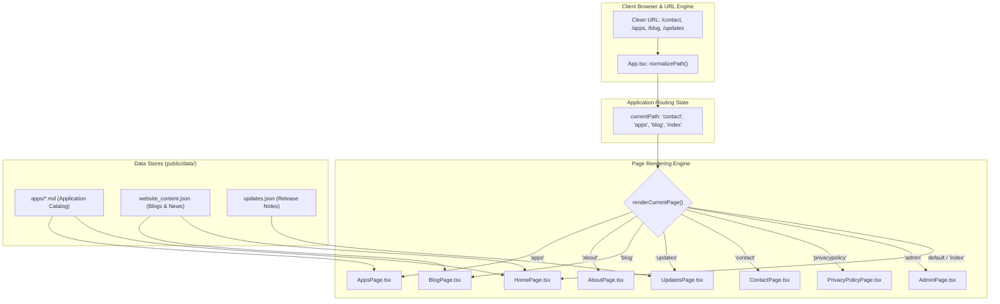
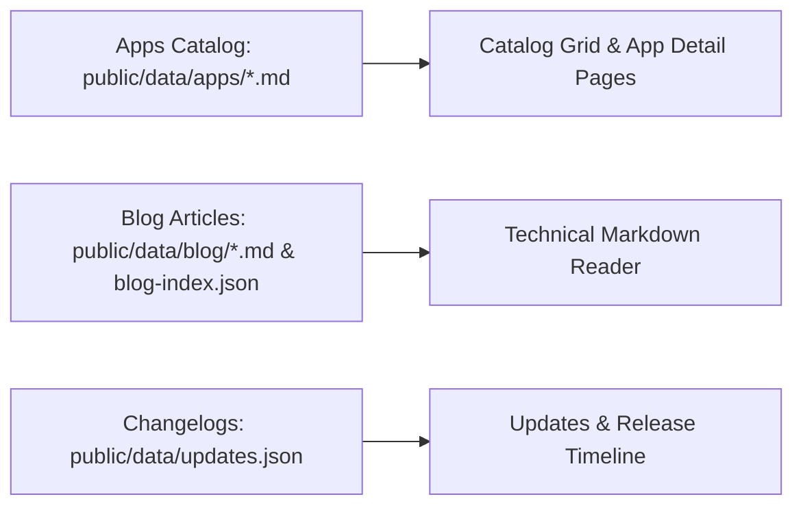
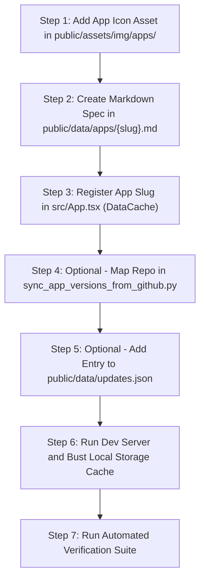
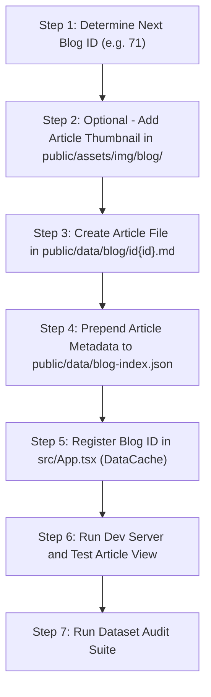
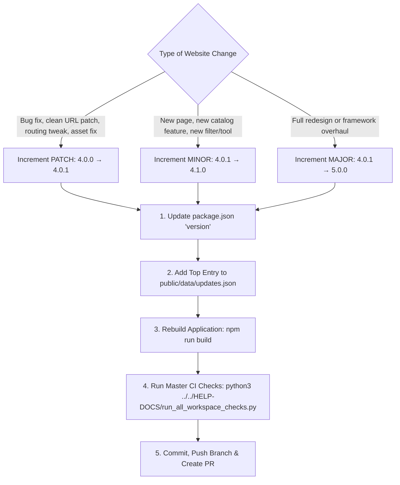

# EG1 Web Portal Developer & Operations Manual (`eg1.in`)

This manual provides clear, comprehensive, step-by-step instructions to maintain, update, extend, and deploy the **`eg1.in`** portal without needing to inspect the underlying source code.

---

## 🏗️ 1. Architecture & Component Flow

`eg1.in` is an independent React 18 + TypeScript + Vite Single Page Application (SPA) consuming `eg-web-core` as a modular dependency.



---

## 📄 2. Procedure: Add, Edit, or Remove a Page

### How to Add a New Page:
1. **Create the Page Component** in `src/pages/MyNewPage.tsx`:
   ```tsx
   import React from 'react';
   import { Container, PageHeader } from 'eg-web-core';

   export interface MyNewPageProps {
     onNavigate: (href: string) => void;
   }

   export const MyNewPage: React.FC<MyNewPageProps> = ({ onNavigate }) => {
     return (
       <div className="my-new-page">
         <Container>
           <PageHeader title="My New Page" subtitle="Description of this section" />
           <p>Page content goes here.</p>
         </Container>
       </div>
     );
   };
   ```

2. **Register the Clean Route in `src/App.tsx`**:
   - Add your route to `normalizePath()`:
     ```ts
     const normalizePath = (path: string): string => {
       const clean = path.replace(/^\/+/, '').split('?')[0].split('#')[0];
       if (!clean || clean === 'index') return 'index';
       const lower = clean.toLowerCase().replace(/\.html$/, '');
       if (lower === 'my-new-page') return 'my-new-page';
       // ... existing routes
     ```
   - Add the page rendering case inside `renderCurrentPage()`:
     ```tsx
     case 'my-new-page':
       return <MyNewPage onNavigate={handleNavigate} />;
     ```

3. **Add Navigation Link** in `src/config/siteConfig.tsx`:
   Add an entry into `EG1_NAV_LINKS`:
   ```tsx
   {
     label: 'MY PAGE',
     href: 'my-new-page',
     icon: <Icon name="star" size={14} />,
   }
   ```

### How to Remove a Page:
1. Remove its entry from `EG1_NAV_LINKS` in `src/config/siteConfig.tsx`.
2. Delete its `case` statement in `src/App.tsx`'s `renderCurrentPage()`.
3. Safely delete the file in `src/pages/`.

---

## 📦 3. Procedure: Content Management (Apps, Blogs & Updates)

All website content is managed via modular files in `public/data/`:



---

### A. How to Add a New Application (Step-by-Step)

Follow these 7 steps to add a new application or project to the `eg1.in` catalog:



#### Step 1: Add the Application Icon
Place the icon asset in the [`public/assets/img/apps/`](../public/assets/img/apps/) directory:
- **Filename**: `<app-slug>.<png|webp|svg>` (e.g. `debian-dev-suite.png`).
- **Format**: PNG, WebP, or SVG (transparent background recommended, minimum 256×256px).

#### Step 2: Create the Application Markdown File
Create a new Markdown file at `public/data/apps/<app-slug>.md` (e.g. `debian-dev-suite.md` in [`public/data/apps/`](../public/data/apps/)) with YAML frontmatter:

```yaml
---
id: "debian-dev-suite"
name: "Debian Dev Suite"
slug: "debian-dev-suite"
category: "Tools/Linux"
product_type: "Desktop App"
version:
  version-string: "1.0.0"
  fetch-github: "false"
active: "1"
createdAt: "2026-11-15T00:00:00+05:30"
updatedAt: "2026-11-15T21:48:54.896570+05:30"
icon: "./assets/img/apps/debian-dev-suite.png"
webapp_link: "https://eg1.in/apps?title=debian-dev-suite"
short_description: "A modular, ultra-lightweight, 100% open-source developer environment toolkit for Debian and Linux distributions."
button1:
  WEBSITE: "https://eg1.in/apps?title=debian-dev-suite"
  sameTab: "false"
  icon: "icon-external-link"
button2:
  SOURCE: "https://github.com/EG1DOTIN/debian-dev-suite"
  sameTab: "false"
  icon: "icon-github"
---

*Debian Dev Suite* is a modular, ultra-lightweight, 100% open-source developer environment toolkit for Debian, MX Linux, antiX, Ubuntu, and Debian-derived distributions.

### Overview
Detailed Markdown description here...

### Features
- Ultra-lightweight and battery-efficient
- 100% privacy-focused (zero telemetry)
- Automated toolchain configuration
```

**YAML Frontmatter Field Reference:**
| Field | Type | Description |
| :--- | :--- | :--- |
| `id` | String | Unique catalog identifier (e.g. `"debian-dev-suite"`). |
| `name` | String | User-facing display title for cards and modals. |
| `slug` | String | URL-safe slug used for clean links (`/apps?title=<slug>`). |
| `category` | String | Filter category (e.g. `"Tools/Linux"`, `"Security/Tools"`, `"Productivity"`). |
| `product_type` | String | Badge text (e.g. `"Desktop App"`, `"Web Application"`, `"Library"`). |
| `version.version-string` | String | Semantic version number (e.g. `"1.0.0"`). |
| `version.fetch-github` | String | `"false"` (prevents client-side GitHub API rate-limiting; updated at build time). |
| `active` | String | `"1"` to display in catalog, `"0"` to hide. |
| `createdAt` | String | ISO 8601 creation timestamp. |
| `updatedAt` | String | ISO 8601 last update timestamp. |
| `icon` | String | Relative path to the icon asset from `public/`. |
| `webapp_link` | String | Primary URL or app detail deep link. |
| `short_description` | String | 1–2 sentence summary shown on catalog cards. |
| `button1` | Object | Primary CTA button with `WEBSITE`, `sameTab`, and `icon`. |
| `button2` | Object | Secondary action button (optional) with `SOURCE`, `sameTab`, and `icon`. |

#### Step 3: Register the App Slug in `src/App.tsx` (CRITICAL)
Open [`src/App.tsx`](../src/App.tsx) and add your new app slug to the `DataCache.registerAppSlugs` array:

```tsx
// src/App.tsx (around line 13)
DataCache.registerAppSlugs([
  'marwadi-chess',
  'pyegclamui',
  'eg-web-core',
  'debian-dev-suite', // <-- Add your new slug here
]);
```

> [!IMPORTANT]
> **Why this step is required**: To eliminate unneeded network lookups, `eg-web-core`'s `DataCache.getProducts({ mdDir: 'data/apps/' })` iterates exclusively over slugs registered via `DataCache.registerAppSlugs()`. Without this registration, the app markdown file will not be fetched or displayed when running `npm run dev` or in production.

#### Step 4: Map GitHub Repo for Automated Version Sync (Optional)
If the project has an external GitHub repository and you want automated build-time release version synchronization, open [`automation-scripts/sync_app_versions_from_github.py`](../automation-scripts/sync_app_versions_from_github.py) and add the mapping:

```python
APP_REPO_MAPPING = {
    "debian-dev-suite": "EG1DOTIN/debian-dev-suite",
    "eg-web-core": "EG1DOTIN/eg-web-core",
    "pyegclamui": "EG1DOTIN/pyEGClamUI",
    "marwadi-chess": "EG1DOTIN/mchess.eg1.in",
}
```

Run synchronization whenever a new release is published:
```bash
python3 automation-scripts/sync_app_versions_from_github.py
```

This script:
1. Queries GitHub for the latest release tags of mapped applications.
2. Updates `public/data/apps/{slug}.md` frontmatter (`version-string`) and sets `fetch-github: "false"`.
3. Eliminates client-side runtime calls to `api.github.com`, preventing 403 rate-limiting and ensuring instant 0ms loads.

Verify synchronization using:
```bash
python3 automation-scripts/audits/audit_app_versions.py
```

#### Step 5: Add Changelog & Bell Notification (Optional)
To feature the new release in the notification bell and on the [`/updates`](../public/data/updates.json) timeline, prepend a new entry to the array in [`public/data/updates.json`](../public/data/updates.json):

```json
{
  "id": "update-2026-11-15-debian-dev-suite",
  "type": "website",
  "version": "1.0.0",
  "title": "Debian Dev Suite v1.0.0 Released",
  "date": "Nov 15, 2026",
  "category": "APP",
  "icon": "shield-check",
  "badge": "New App",
  "description": "Modular, ultra-lightweight developer environment toolkit for Debian, MX Linux, antiX, Ubuntu, and Debian-derived distributions.",
  "link": "apps?title=debian-dev-suite"
}
```

#### Step 6: Test Locally & Invalidate Browser Cache
1. Start the Vite development server:
   ```bash
   npm run dev
   ```
2. Open your browser at `http://localhost:5174/apps`.
3. Test direct deep-linking to your new app:
   `http://localhost:5174/apps?title=debian-dev-suite`
4. **Cache Invalidation**: Because `DataCache` stores parsed catalog entries in `localStorage`, force a clean reload using:
   - Hard refresh: `Ctrl + Shift + R`
   - Cache-busting URL parameter: `http://localhost:5174/apps?refresh=1`
   - Or clear site data via DevTools Console: `localStorage.clear()`

#### Step 7: Run Automated Verification Suite
Ensure all datasets, schemas, and links pass validation:
```bash
python3 automation-scripts/run_all_checks.py
```

---

### B. How to Add a New Technical Blog Article (Step-by-Step)

The `eg1.in` blog engine delivers 47+ technical articles with instant zero-Firestore-read performance by pairing pre-indexed JSON metadata with modular Markdown article files.

Follow these 7 steps to publish a new article:



#### Step 1: Determine the Next Blog ID
Inspect [`public/data/blog-index.json`](../public/data/blog-index.json) or [`public/data/blog/`](../public/data/blog/) to find the highest existing ID (e.g. `70`). The next ID will be `71`.

#### Step 2: Add Article Thumbnail (Optional / Recommended)
Place the article header image in [`public/assets/img/blog/`](../public/assets/img/blog/):
- **Filename**: `id<id>.webp` (e.g. `id71.webp`).
- **Dimensions**: 800×450px recommended (16:9 aspect ratio).

#### Step 3: Create the Article Markdown File
Create a new file at `public/data/blog/id<id>.md` (e.g. `id71.md` in [`public/data/blog/`](../public/data/blog/)) with YAML frontmatter:

```yaml
---
id: "71"
title: "Getting Started with Python AsyncIO and High Concurrency"
heading: "Getting Started with Python AsyncIO and High Concurrency"
category: "Python"
tags: ["Python", "AsyncIO", "Tutorials", "Concurrency"]
author: "EG1"
createdAt: "2026-11-15"
release_date: "2026-11-15"
updatedAt: "2026-11-15T12:00:00.000Z"
output_image: "assets/img/blog/id71.webp"
short_description: "Learn how to use async/await and asyncio.gather in modern Python to build fast, non-blocking applications."
end_description: ""
metaKeyword: "Python, AsyncIO, Coroutines, Concurrency"
metaDescription: "Learn how to use async/await and asyncio.gather in modern Python to build fast, non-blocking applications."
active: "1"
---

# Introduction to AsyncIO

Asynchronous programming in Python allows your application to handle multiple I/O tasks (like network requests or file operations) without blocking the main thread.

## 1. Defining an Async Coroutine

In modern Python (3.7+), coroutines are declared using `async def`:

```python
import asyncio

async def fetch_data(task_id: int, delay: float) -> str:
    print(f"Task {task_id} starting...")
    await asyncio.sleep(delay)
    print(f"Task {task_id} finished!")
    return f"Result {task_id}"

async def main():
    result = await fetch_data(1, 1.5)
    print(result)

if __name__ == "__main__":
    asyncio.run(main())
```

## 2. Running Tasks Concurrently

Use `asyncio.gather()` to execute multiple tasks concurrently:

```python
async def main():
    results = await asyncio.gather(
        fetch_data(1, 2.0),
        fetch_data(2, 1.0),
        fetch_data(3, 1.5)
    )
    print("All tasks completed:", results)
```

## Summary
AsyncIO is ideal for I/O-bound workflows including web scraping, microservices, and chat APIs.
```

**YAML Frontmatter Field Reference for Blogs:**
| Field | Type | Description |
| :--- | :--- | :--- |
| `id` | String | Numeric article ID matching the filename (e.g. `"71"`). |
| `title` | String | Full title of the blog post. |
| `heading` | String | Main heading displayed at the top of the article view. |
| `category` | String | Primary category tag (e.g. `"Python"`, `"C++"`, `"Architecture"`). |
| `tags` | Array | Array of string tags for sidebar filtering. |
| `author` | String | Author name (e.g. `"EG1"`). |
| `createdAt` | String | Date string `YYYY-MM-DD`. |
| `release_date` | String | Date string `YYYY-MM-DD`. |
| `updatedAt` | String | ISO 8601 update timestamp. |
| `output_image` | String | Path to thumbnail image (e.g. `"assets/img/blog/id71.webp"`). |
| `short_description` | String | 1–2 sentence summary for blog cards and preview lists. |
| `metaDescription` | String | Meta description for SEO and social sharing tags. |
| `active` | String | `"1"` to publish, `"0"` to draft/hide. |

#### Step 4: Prepend Entry to `public/data/blog-index.json` (CRITICAL)
Open [`public/data/blog-index.json`](../public/data/blog-index.json) and add the article object at the very top of the JSON array:

```json
[
  {
    "id": "71",
    "slug": "getting-started-with-python-asyncio-and-high-concurrency",
    "title": "Getting Started with Python AsyncIO and High Concurrency",
    "description": "Learn how to use async/await and asyncio.gather in modern Python to build fast, non-blocking applications.",
    "content": "# Introduction to AsyncIO\n\nAsynchronous programming in Python allows your application to handle multiple I/O tasks...\n",
    "date": "2026-11-15",
    "author": "EG1",
    "tags": [
      "Python",
      "AsyncIO",
      "Tutorials",
      "Concurrency"
    ],
    "readingTime": "4 min read"
  },
  ...
]
```

> [!IMPORTANT]
> **Why `blog-index.json` is required**: `useBlogs('data/blog-index.json', 'data/blog/')` reads this static index to render blog cards, category counts, tag filters, and pagination instantly on first page load without making 47+ individual network requests. The dataset validation script strictly enforces that every entry in `blog-index.json` has a corresponding non-empty `id<id>.md` file.

#### Step 5: Register Blog ID in `src/App.tsx`
Open [`src/App.tsx`](../src/App.tsx) and add your new blog ID string to `DataCache.registerBlogIds`:

```tsx
// src/App.tsx (around lines 14-19)
DataCache.registerBlogIds([
  '6', '7', '10', '11', '12', '13', '14', '15', '16', '17', '18', '19', '20',
  '21', '35', '36', '37', '38', '39', '40', '41', '42', '43', '44', '45', '46',
  '47', '48', '49', '50', '51', '53', '54', '55', '56', '57', '58', '59', '60',
  '61', '62', '63', '64', '67', '68', '69', '70',
  '71' // <-- Add your new blog ID here
]);
```

#### Step 6: Test Locally & Invalidate Cache
1. Start the Vite server:
   ```bash
   npm run dev
   ```
2. Open `http://localhost:5174/blog`.
3. Verify your article appears at the top of the blog grid.
4. Test direct navigation by ID and slug:
   - `http://localhost:5174/blog?id=71`
   - `http://localhost:5174/blog?title=getting-started-with-python-asyncio-and-high-concurrency`
5. Test category filter and search query.
6. If the browser displays cached articles, hard refresh with `Ctrl + Shift + R` or `http://localhost:5174/blog?refresh=1`.

#### Step 7: Run Dataset Verification Audit
Run the dataset integrity check:
```bash
python3 automation-scripts/audits/validate_datasets.py
```
This confirms that:
- `blog-index.json` is valid JSON.
- Every entry has a corresponding non-empty `public/data/blog/id<id>.md` file.
- Total count and schemas match production standards.

---

### C. How to Add a Release Update in `public/data/updates.json`:
Add to the top of the array:
```json
{
  "id": "v4-1-0",
  "title": "EG1 Portal v4.1.0 Released",
  "date": "November 2026",
  "badge": "Update",
  "badgeType": "emerald",
  "summary": "Added clean URLs and updated catalog search indexing.",
  "link": "updates#v4-1-0"
}
```

---

## 🔐 4. Procedure: Configure Admin Security & Credentials

The portal features a hardened 3-tier administrative dashboard (`/admin`):
1. **Google OAuth Login**: Whitelist enforced.
2. **16-Digit Salted SHA-256 PIN Challenge**: Computed entirely client-side via standard browser Web Crypto API.
3. **Automated Brute-Force Lockout Defense**: 3 consecutive failed PIN attempts trigger a 24-hour lockout.

### Setting Up Environment Variables:
Create `.env` in `EG1-WEBSITE/eg1.in/` (never committed to git):
```ini
# Comma-separated admin email whitelist
VITE_ADMIN_ALLOWED_EMAILS=admin@example.com

# 16-Digit Admin PIN Hash (SHA-256 of Salt + PIN)
VITE_ADMIN_PIN_HASH=your_computed_sha256_hash_here

# Unique Secret Salt
VITE_ADMIN_PIN_SALT=your_secret_salt_here
```

---

## 🚀 5. Development, Build & Deployment Commands

Run these commands from `EG1-WEBSITE/eg1.in/`:

```bash
# 1. Start local Vite development server (hot reload on http://localhost:5173)
npm run dev

# 2. Type-check TypeScript code
npm run typecheck

# 3. Build optimized production bundle to dist/
npm run build

# 4. Preview the production build locally
npm run preview

# 5. Deploy to Firebase Hosting (Production)
firebase deploy --only hosting
```

---

## 🏷️ 6. How to Bump & Release a New Website Version

`eg1.in` follows [Semantic Versioning (SemVer)](https://semver.org/): `MAJOR.MINOR.PATCH` (e.g. `4.0.0` → `4.0.1`).



### Step-by-Step Procedure:

1. **Update `package.json`**:
   Open [`package.json`](../package.json) and bump the `"version"` field:
   ```json
   {
     "name": "eg1-in",
     "version": "4.0.1",
     ...
   }
   ```

2. **Add Changelog Entry to `public/data/updates.json`**:
   Open [`public/data/updates.json`](../public/data/updates.json) and prepend a new entry at the very top of the JSON array:
   ```json
   [
       {
           "id": "update-2026-11-03-v4-0-1",
           "type": "website",
           "version": "4.0.1",
           "title": "Clean Extension-Agnostic URL Routing & Comprehensive Developer Documentation Suite",
           "date": "Nov 03, 2026",
           "category": "BUG-FIX",
           "icon": "shield-check",
           "badge": "Patch",
           "description": "Resolved clean URL routing behavior ensuring extensionless paths resolve directly without fallback to index.",
           "link": "https://github.com/EG1DOTIN/eg1.in"
       },
       ...
   ]
   ```
   *Available Category values*: `BUG-FIX`, `ENHANCEMENT`, `OPTIMIZATION`, `FEATURE`, `APP`, `OTHER`.

3. **Verify Build & Type Safety**:
   ```bash
   npm run build
   ```

4. **Run Master Workspace Verification**:
   ```bash
   python3 ../../HELP-DOCS/run_all_workspace_checks.py
   ```

5. **Commit & Deploy**:
   ```bash
   git add package.json public/data/updates.json
   git commit -m "chore(release): bump eg1.in to 4.0.1"
   # To deploy to production:
   firebase deploy --only hosting
   ```


