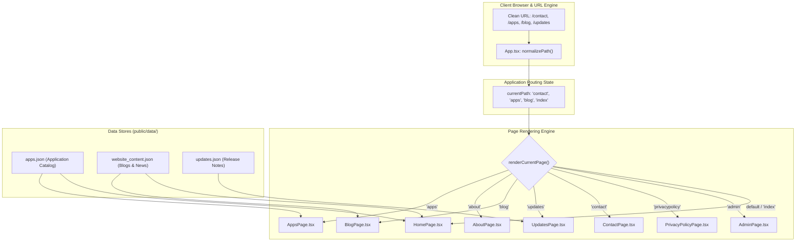
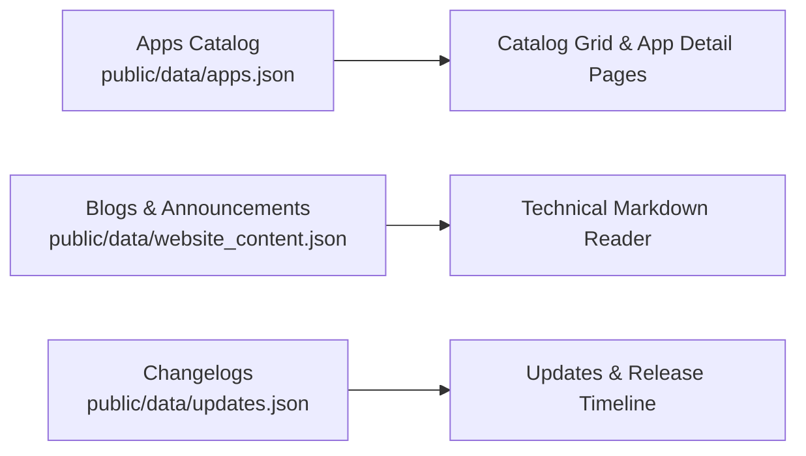
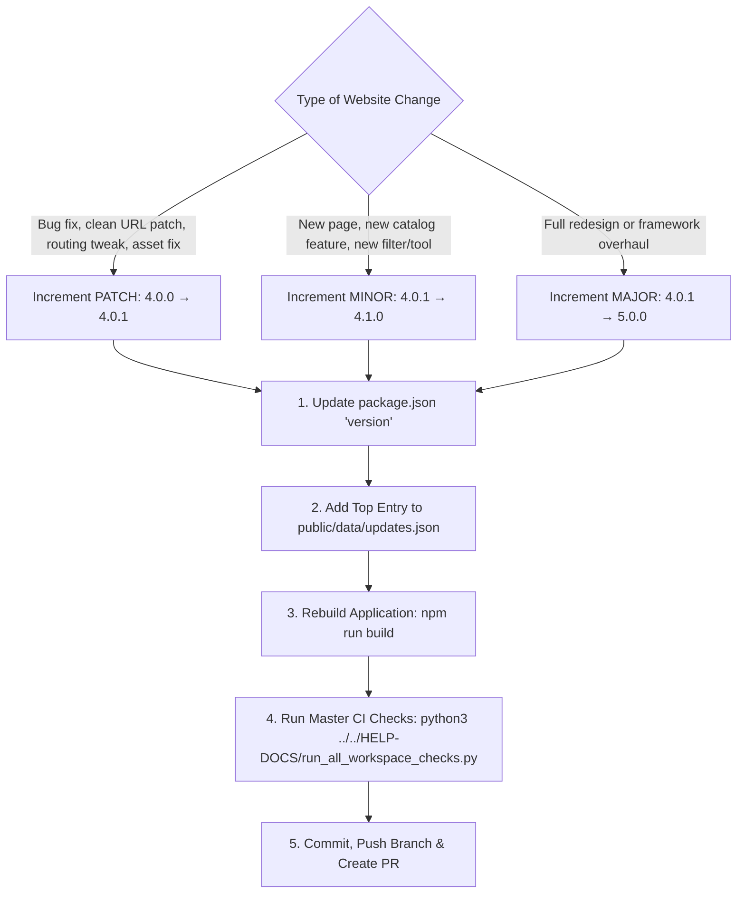

# EG1 Web Portal Developer & Operations Manual (`eg1.in`)

This manual provides clear, comprehensive, step-by-step instructions to maintain, update, extend, and deploy the **`eg1.in`** portal without needing to inspect the underlying source code.

---

## 🏗️ 1. Architecture & Component Flow

`eg1.in` is an independent React 18 + TypeScript + Vite Single Page Application (SPA) consuming `eg-web-core` as a modular dependency.



---

## 📄 2. Procedure: Add, Edit, or Remove a Page

### How to Add a New Page:
1. **Create the Page Component** in `src/pages/MyNewPage.tsx`:
   ```tsx
   import React from 'react';
   import { Container, PageHeader } from 'eg-web-core';

   export interface MyNewPageProps {
     onNavigate: (href: string) => void;
   }

   export const MyNewPage: React.FC<MyNewPageProps> = ({ onNavigate }) => {
     return (
       <div className="my-new-page">
         <Container>
           <PageHeader title="My New Page" subtitle="Description of this section" />
           <p>Page content goes here.</p>
         </Container>
       </div>
     );
   };
   ```

2. **Register the Clean Route in `src/App.tsx`**:
   - Add your route to `normalizePath()`:
     ```ts
     const normalizePath = (path: string): string => {
       const clean = path.replace(/^\/+/, '').split('?')[0].split('#')[0];
       if (!clean || clean === 'index') return 'index';
       const lower = clean.toLowerCase().replace(/\.html$/, '');
       if (lower === 'my-new-page') return 'my-new-page';
       // ... existing routes
     ```
   - Add the page rendering case inside `renderCurrentPage()`:
     ```tsx
     case 'my-new-page':
       return <MyNewPage onNavigate={handleNavigate} />;
     ```

3. **Add Navigation Link** in `src/config/siteConfig.tsx`:
   Add an entry into `EG1_NAV_LINKS`:
   ```tsx
   {
     label: 'MY PAGE',
     href: 'my-new-page',
     icon: <Icon name="star" size={14} />,
   }
   ```

### How to Remove a Page:
1. Remove its entry from `EG1_NAV_LINKS` in `src/config/siteConfig.tsx`.
2. Delete its `case` statement in `src/App.tsx`'s `renderCurrentPage()`.
3. Safely delete the file in `src/pages/`.

---

## 📦 3. Procedure: Content Management (Apps, Blogs & Updates)

All website content is managed via JSON files in `public/data/`:



### A. How to Add an App in `public/data/apps.json`:
Append a new object to the array in `public/data/apps.json`:
```json
{
  "id": "my-tool",
  "name": "My New Tool",
  "category": "Productivity",
  "description": "Short 1-2 sentence description for catalog cards.",
  "status": "Production",
  "version": "1.0.0",
  "tags": ["Desktop", "Open Source", "Utility"],
  "product_type": "DesktopApp",
  "webapp_link": "",
  "attach_upload_file_1": "https://github.com/EG1DOTIN/my-tool/releases",
  "markdownBody": "### Overview\nDetailed Markdown description...\n\n### Features\n- Feature 1\n- Feature 2"
}
```

### B. How to Add a Blog Post in `public/data/website_content.json`:
Add to the `"blog_posts"` array:
```json
{
  "id": "71",
  "title": "My New Engineering Guide",
  "date": "November 2026",
  "category": "Engineering",
  "author": "EG1",
  "summary": "Brief summary of the article.",
  "readTime": "5 min read",
  "markdown": "# My Guide\n\nContent in Markdown...\n\n```python\nprint('Hello World')\n```"
}
```
*Note: Register the new blog ID in `src/App.tsx` (`DataCache.registerBlogIds(['71'])`) to enable offline caching.*

### C. How to Add a Release Update in `public/data/updates.json`:
Add to the top of the array:
```json
{
  "id": "v4-1-0",
  "title": "EG1 Portal v4.1.0 Released",
  "date": "November 2026",
  "badge": "Update",
  "badgeType": "emerald",
  "summary": "Added clean URLs and updated catalog search indexing.",
  "link": "updates#v4-1-0"
}
```

---

## 🔐 4. Procedure: Configure Admin Security & Credentials

The portal features a hardened 3-tier administrative dashboard (`/admin`):
1. **Google OAuth Login**: Whitelist enforced.
2. **16-Digit Salted SHA-256 PIN Challenge**: Computed entirely client-side via standard browser Web Crypto API.
3. **Automated Brute-Force Lockout Defense**: 3 consecutive failed PIN attempts trigger a 24-hour lockout.

### Setting Up Environment Variables:
Create `.env` in `EG1-WEBSITE/eg1.in/` (never committed to git):
```ini
# Comma-separated admin email whitelist
VITE_ADMIN_ALLOWED_EMAILS=admin@example.com

# 16-Digit Admin PIN Hash (SHA-256 of Salt + PIN)
VITE_ADMIN_PIN_HASH=your_computed_sha256_hash_here

# Unique Secret Salt
VITE_ADMIN_PIN_SALT=your_secret_salt_here
```

---

## 🚀 5. Development, Build & Deployment Commands

Run these commands from `EG1-WEBSITE/eg1.in/`:

```bash
# 1. Start local Vite development server (hot reload on http://localhost:5173)
npm run dev

# 2. Type-check TypeScript code
npm run typecheck

# 3. Build optimized production bundle to dist/
npm run build

# 4. Preview the production build locally
npm run preview

# 5. Deploy to Firebase Hosting (Production)
firebase deploy --only hosting
```

---

## 🏷️ 6. How to Bump & Release a New Website Version

`eg1.in` follows [Semantic Versioning (SemVer)](https://semver.org/): `MAJOR.MINOR.PATCH` (e.g. `4.0.0` → `4.0.1`).



### Step-by-Step Procedure:

1. **Update `package.json`**:
   Open [`package.json`](../package.json) and bump the `"version"` field:
   ```json
   {
     "name": "eg1-in",
     "version": "4.0.1",
     ...
   }
   ```

2. **Add Changelog Entry to `public/data/updates.json`**:
   Open [`public/data/updates.json`](../public/data/updates.json) and prepend a new entry at the very top of the JSON array:
   ```json
   [
       {
           "id": "update-2026-11-03-v4-0-1",
           "type": "website",
           "version": "4.0.1",
           "title": "Clean Extension-Agnostic URL Routing & Comprehensive Developer Documentation Suite",
           "date": "Nov 03, 2026",
           "category": "BUG-FIX",
           "icon": "shield-check",
           "badge": "Patch",
           "description": "Resolved clean URL routing behavior ensuring extensionless paths resolve directly without fallback to index.",
           "link": "https://github.com/EG1DOTIN/eg1.in"
       },
       ...
   ]
   ```
   *Available Category values*: `BUG-FIX`, `ENHANCEMENT`, `OPTIMIZATION`, `FEATURE`, `APP`, `OTHER`.

3. **Verify Build & Type Safety**:
   ```bash
   npm run build
   ```

4. **Run Master Workspace Verification**:
   ```bash
   python3 ../../HELP-DOCS/run_all_workspace_checks.py
   ```

5. **Commit & Deploy**:
   ```bash
   git add package.json public/data/updates.json
   git commit -m "chore(release): bump eg1.in to 4.0.1"
   # To deploy to production:
   firebase deploy --only hosting
   ```


