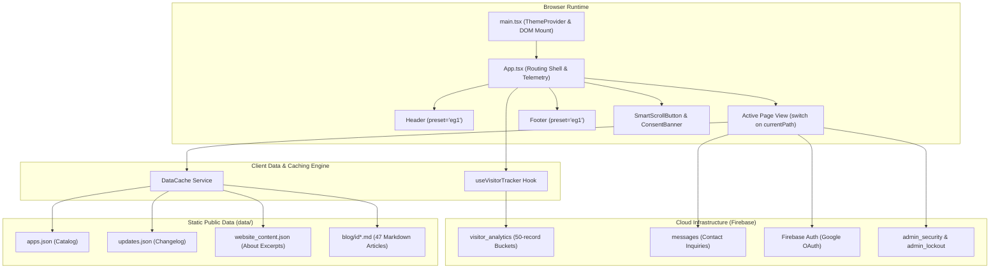
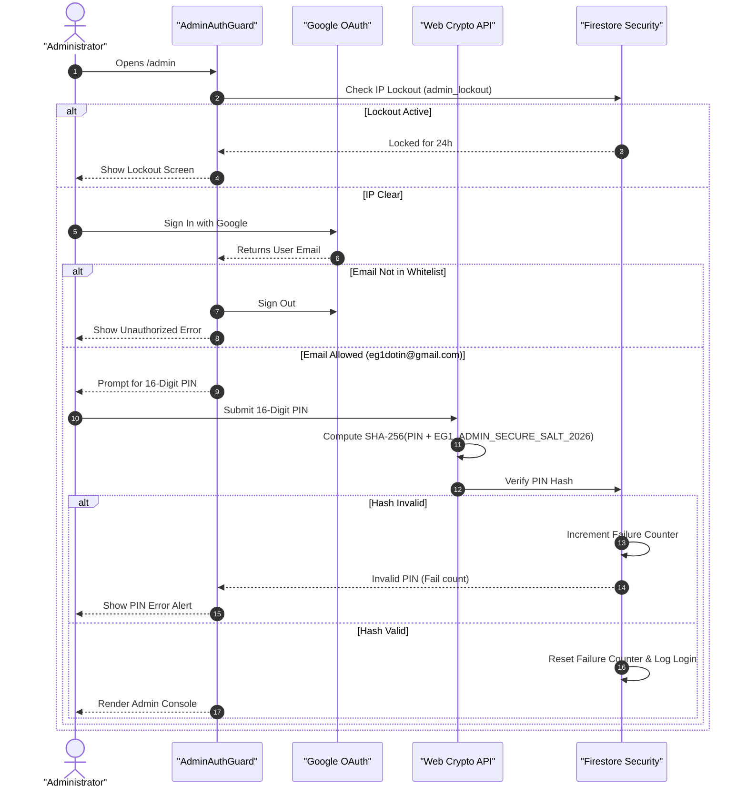

# Architecture & Data Flow — EG1 Portal

This document outlines the architecture, data management strategy, caching mechanisms, and security patterns powering [`eg1.in`](../).

---

## 🏗️ Architectural Topology



---

## 1. Client-Side Routing & Path Normalization

The routing engine in [`App.tsx`](../src/App.tsx) provides client-side Single Page Application (SPA) navigation while maintaining 100% compatibility with static `.html` filenames and clean URLs.

### Path Normalizer Logic
```typescript
const normalizePath = (path: string): string => {
  const clean = path.replace(/^\/+/, '').split('?')[0].split('#')[0];
  if (!clean || clean === 'index.html') return 'index.html';
  const lower = clean.toLowerCase();
  if (
    lower === 'admin' ||
    lower === 'admin.html' ||
    lower.startsWith('admin/') ||
    lower === 'adminpanel' ||
    lower === 'adminpanel.html' ||
    lower.startsWith('adminpanel/')
  ) {
    return 'admin.html';
  }
  return clean;
};
```

### Full-Screen Isolation for Admin Console
When `currentPath === 'admin.html'`, the application bypasses the public `<Header />` and `<Footer />` shells to provide a distraction-free, dedicated administrative workstation with an internal "Exit to Website" action.

---

## 2. Zero-Firestore Reads Pattern (`DataCache`)

To eliminate recurring Firestore read charges for static content, EG1 utilizes the [`DataCache`](https://github.com/EG1DOTIN/eg-web-core/blob/main/docs/hooks-and-services.md) pattern:

1. **Pre-Registration**:
   At application initialization, [`App.tsx`](../src/App.tsx) registers application catalog slugs and blog post IDs:
   ```typescript
   DataCache.registerAppSlugs(['marwadi-chess', 'pyegclamui', 'test1-app', 'test2-app']);
   DataCache.registerBlogIds([
     '6', '7', '10', '11', '12', '13', '14', '15', '16', '17', '18', '19', '20',
     '21', '35', '36', '37', '38', '39', '40', '41', '42', '43', '44', '45', '46',
     '47', '48', '49', '50', '51', '53', '54', '55', '56', '57', '58', '59', '60',
     '61', '62', '63', '64', '67', '68', '69', '70'
   ]);
   ```
2. **Fetch Once & Cache**:
   Static content is fetched via HTTP GET, cached in browser memory, and indexed for instantaneous lookups.
3. **No Database Dependencies**:
   Public visitors browsing applications, updates, and 47 technical articles produce **zero Firestore document read operations**.

---

## 3. High-Efficiency Telemetry (50-Record Batched Bucket)

The portal integrates [`useVisitorTracker`](https://github.com/EG1DOTIN/eg-web-core/blob/main/docs/hooks-and-services.md) to record anonymous session telemetry:
- **Batched Bucket Pattern**: Sessions are appended to an array in memory and committed to Firestore collection `visitor_analytics` only when a bucket of 50 records fills, or during periodic sync.
- **Quota Reduction**: Reduces database writes by **98%** compared to traditional 1-write-per-visitor logging.
- **Privacy-First**: No personally identifiable information (PII) is captured. Users can opt out at any time via the consent banner.

---

## 4. Admin Security Topology

The administration panel (`/admin`) enforces a 3-tier defense-in-depth model:


