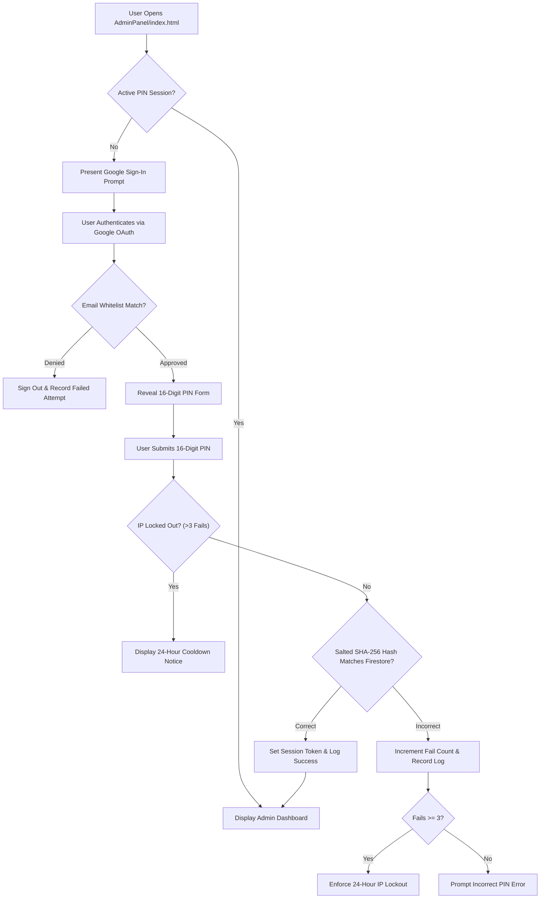

# Page Details: Admin Panel & Security Architecture (`AdminPanel/index.html`)

High-level technical architecture, multi-tiered defense-in-depth security model, visitor telemetry inspection, contact message administration, TableToolkit data engine, and UI specifications for the EG1 Administrative Console.

---

## 🔗 Associated Code Files

- **HTML Template**: [AdminPanel/index.html](../../AdminPanel/index.html)
- **Authentication & Security Controller**: [AdminPanel/js/auth.js](../../AdminPanel/js/auth.js)
- **Dashboard & Core Admin Controller**: [AdminPanel/js/admin.js](../../AdminPanel/js/admin.js)
- **Telemetry & Analytics Module**: [AdminPanel/js/analytics.js](../../AdminPanel/js/analytics.js)
- **Contact Messages Module**: [AdminPanel/js/messages.js](../../AdminPanel/js/messages.js)
- **Modular Data Table Engine**: [AdminPanel/js/table-toolkit.js](../../AdminPanel/js/table-toolkit.js)
- **Firebase Client Configuration**: [AdminPanel/firebase-config.js](../../AdminPanel/firebase-config.js)
- **Stylesheet**: [AdminPanel/css/admin-style.css](../../AdminPanel/css/admin-style.css)

---

## 🎨 UI Wireframe & Layout

### 1. Two-Step Authentication Gate (`#loginContainer`)
```
+-------------------------------------------------------------------------+
|                           ADMIN PANEL LOGIN                             |
|                                                                         |
|  [Step 1: Federated Google Sign-In]                                     |
|  "Sign in with your authorized Google account to continue."             |
|  [ (G) Sign in with Google ]                                            |
|                                                                         |
|  [Step 2: 16-Digit Grouped Security PIN (Revealed Post-Auth)]           |
|  "Enter your 16-Digit Admin Security PIN (4 digits in each group)."     |
|  [ •••• ] — [ •••• ] — [ •••• ] — [ •••• ]                              |
|  [ Unlock Panel ]                                                       |
|  [ Cancel & Logout ]                                                    |
+-------------------------------------------------------------------------+
```

### 2. Administrative Workspace Dashboard (`#adminDashboard`)
```
+-------------------------------------------------------------------------+
| [EG1 Admin]  | Topbar: [Theme Toggle: Light/Dark] [User Email] [Logout] |
+--------------+----------------------------------------------------------+
| SIDEBAR NAV  | MAIN CONTENT WORKSPACE                                   |
|              |                                                          |
| - Dashboard  | [KPI Cards: Total Visitors | Today's Visitors]           |
| - Analytics  |                                                          |
| - Messages   | [Filter: All Projects v] [Search: IP, OS, Browser...]    |
| - Logout     | +------------------------------------------------------+ |
|              | | Timestamp | App | Location | IP | Device | Browser... | |
|              | |-----------+-----+----------+----+--------+------------| |
|              | | [TableToolkit Sortable & Paginated Telemetry Grid]   | |
|              | +------------------------------------------------------+ |
|              | [ << First | < Prev | Page 1 of N | Next > | Last >> ]   |
+-------------------------------------------------------------------------+
```

---

## ⚡ Mermaid Authentication & Access Flowchart



---

## 🛡️ Multi-Tier Defense-in-Depth Security Model

The administrative interface employs four distinct protective layers to enforce access control:

| Security Layer | Defensive Mechanism | Architectural Protection |
| :--- | :--- | :--- |
| **Tier 1: Federated Identity** | Google OAuth 2.0 Whitelist | Restricts authentication strictly to designated administrator credentials with hardware 2-Factor Authentication (2FA). |
| **Tier 2: Cryptographic Passcode** | 16-Digit Grouped Security PIN | Secondary access barrier requiring 16 numeric digits ($10^{16}$ combinations) validated via salted SHA-256 one-way hashing. |
| **Tier 3: Threat Mitigation & Lockout** | 24-Hour IP Rate Limiting | Progressive attempt counter triggering a strict 24-hour network lockout upon 3 consecutive failed attempts. |
| **Tier 4: Backend Security Rules** | Firestore Access Control Rules | Backend-enforced rule validation ensuring only authenticated administrator UIDs can execute document reads and writes. |

---

## 📊 Core Administrative Capabilities

### 1. Visitor Telemetry & Analytics Engine
- **Batched Bucket Storage**: Stores telemetry in paginated bucket documents (`page_N`, up to 18 records per document) to minimize Firestore read quotas.
- **16 Telemetry Dimensions**: Captures comprehensive anonymous metrics including visit timestamp, destination page, referrer, public IP/network, screen resolution, operating system, browser engine, and approximate geolocation.
- **Cross-App Subdomain Filtering**: Filter telemetry streams across the primary portal (`eg1.in`) and dedicated tools (e.g. `mchess.eg1.in`).

### 2. Inbound Contact Message Management
- **Centralized Message Feed**: Real-time review of submissions originating from the public contact portal.
- **Anti-Spam Verification**: Integrates with backend Firestore validation ensuring all submitted messages adhere to server-side schema limits and anti-spam constraints.

### 3. Modular TableToolkit Data Engine
- **Natural Alphanumeric Sorting**: Utilizes JavaScript `Intl.Collator` for intelligent, human-friendly alphabetical and numeric column sorting.
- **Multi-Type Sorting**: Native handling for dates, numeric quantities, and text strings with ascending/descending toggles.
- **Universal Pagination**: Dynamic page navigation, customizable items-per-page thresholds, and live record search across all columns.

### 4. Dual-Theme Interface Synchronization
- **Zero-Flicker Pre-loader**: Inlines theme detection in `<head>` to prevent Flash of Unstyled Content (FOUC).
- **Theme Tokens**: Seamless switching between Light Gray and Dark Gray palettes via centralized CSS Custom Properties (`--bg-primary`, `--card-bg`, `--text-primary`).

---

## 🔒 Session & Security Safeguards

- **Ephemeral Session Persistence**: Uses browser `sessionStorage` for authorization state tokens, ensuring credentials auto-expire immediately when the browser tab is closed.
- **XSS Defense**: Strict DOM manipulation using `textContent` and sanitized element creation to prevent cross-site scripting risks.
- **Auditable Security Logs**: Every authentication attempt (successes, unauthorized accounts, invalid PINs) is logged into an append-only audit collection for operational review.
