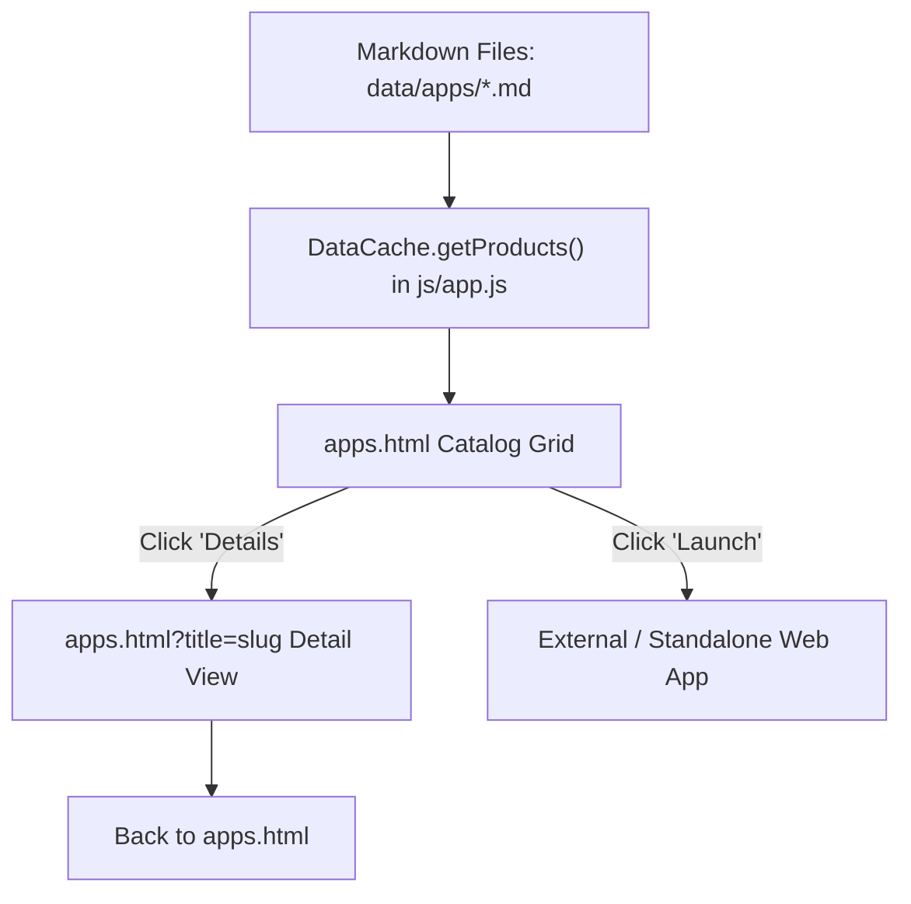
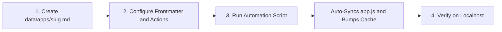

# Page Details: Applications Showcase & Dynamic Detail Views

Technical code architecture, execution logic, algorithm specifications, Mermaid flowcharts, code links, and clipboard fallback algorithms for the EG1 Applications Showcase (`apps.html`) and dynamic application detail views (`apps.html?title=<slug>`) rendered directly from markdown files in `data/apps/`.

---

## 🔗 Associated Code Files

- **Catalog & Detail View Template**: [apps.html](../../apps.html)
- **Catalog Controller**: [js/apps.js](../../assets/js/modules/apps.js)
- **Data Engine & Renderer**: [js/app.js](../../assets/js/core/app.js)
- **Consolidated Automation Runner**: [automation-scripts/run_all_checks.py](../../automation-scripts/run_all_checks.py)
- **Interactive Share Logic**: [js/share-app.js](../../assets/js/modules/share-app.js)
- **Stylesheets**: [css/theme.css](../../assets/css/core/theme.css), [css/common.css](../../assets/css/core/common.css), [css/main.css](../../assets/css/core/main.css)

---

## 🎨 UI Architecture & Layout

```
+-------------------------------------------------------------------------+
| HEADER & NAVIGATION (Loaded via include-components.js)                  |
+-------------------------------------------------------------------------+
| Page Banner: "APPLICATIONS"                                             |
+-------------------------------------------------------------------------+
| MODE 1: CATALOGUE LIST VIEW (apps.html)                                 |
| +---------------------------------------------------------------------+ |
| | [App Icon]  Application Title                      Version 1.0.0    | |
| |             Short description (15.5px, normal style, line-height 1.6)| |
| |             [ VIEW DETAILS / LAUNCH ]   [ DOWNLOAD / SOURCE ]       | |
| +---------------------------------------------------------------------+ |
|                                                                         |
| MODE 2: DYNAMIC IN-PLACE DETAIL VIEW (apps.html?title=<app-slug>)       |
| +---------------------------------------------------------------------+ |
| | [Themed App Icon]  Application Title               Version 1.0.0    | |
| |                    Rendered Markdown Specification & Overview       | |
| |                    Features, GFM Tables, System Requirements        | |
| |                    [ DOWNLOAD / SOURCE ]                            | |
| | ------------------------------------------------------------------- | |
| | [ ← Back to all apps ]                                              | |
| +---------------------------------------------------------------------+ |
+-------------------------------------------------------------------------+
| FOOTER (Loaded via include-components.js)                               |
+-------------------------------------------------------------------------+
```

---

## ⚡ Mermaid Application Architecture Flowchart



---

## 💻 Code-Side Implementation & Algorithm Details

### 1. Pure Markdown Apps Engine & Dynamic In-Place Rendering (`apps.js`)
All application specifications are authored and stored exclusively in [`data/apps/*.md`](../../data/apps/):
- `apps.html` handles both the catalogue grid and dynamic single-app detail cards through client-side query parameters (`apps.html?title=<slug>`).
- Direct web applications (such as **Marwadi Chess**) feature direct `LAUNCH` and `SOURCE` actions.
- Standalone or downloadable applications load full Markdown content into the in-place card view with zero unnecessary HTML file duplicates.
- **Chronological Catalog Ordering**: Applications in the catalog grid (`apps.html`) and cache layer are automatically sorted in chronological order (latest applications on top based on `createdAt` or `updatedAt` descending), ensuring visitors immediately see the newest software releases.

### 2. Themed Web Share API & Toast Fallback (`js/share-app.js`)
Application views include a native Share capability:
- **Mobile & Supported Browsers**: Invokes `navigator.share({ title, text, url })` for seamless native sharing to WhatsApp, Messages, Twitter, etc.
- **Desktop / Fallback**: Copies canonical URL to clipboard via `navigator.clipboard.writeText()` and animates a floating `.share-toast` alert with theme-aware colors.

### 3. Dynamic Version Tracking (`DataCache.resolveProductVersion`)
Versions are resolved dynamically without hardcoding:
1. **GitHub Releases API (`fetch-github: "true"`)**: Real-time version check with persistent `localStorage` caching.
2. **Static Version String (`fetch-github: "false"`)**: Reads `version-string` directly from YAML frontmatter.
3. **Default Fallback**: Automatically defaults to `"1.0.0"`.

### 4. Consolidated Quality Assurance (`run_all_checks.py`)
All audits, page generators, and code compliance checks are executed in a single command via [automation-scripts/run_all_checks.py](../../automation-scripts/run_all_checks.py), completing in ~1.2 seconds.

### 5. Unified Button Theming & Icon Normalization
All action buttons (`DOWNLOAD`, `SOURCE`, `LAUNCH`) and footer navigation buttons (`Back to all apps`) are unified under dynamic CSS Custom Property tokens (`var(--btn-primary-bg)`, `var(--btn-primary-text)`, `var(--btn-primary-border)`):
- **Dark Gray Theme**: Adapts to radiant Sky Blue (`#38bdf8`) with dark navy (`#0f172a`) contrast text and smooth elevation hover transitions.
- **Light Gray Theme**: Adapts to Dark Charcoal (`#2d3748`) with crisp white (`#ffffff`) text.
- **Icon Normalization**: Automatically normalizes icon definitions from `data/apps/*.md` frontmatter (e.g. `icon: icon-cloud-download` &rarr; `icon icon-cloud-download`, or label fallbacks), ensuring 100% visual parity across all views.

### 6. Header Cache Refresh & Reload Button
A dedicated cache-busting button is positioned in the header toolbar between the Notification Bell and the Theme Toggle:
- **Flushes Client Storage**: Wipes `localStorage` Markdown caches (`eg1_apps_md_cache_v2`, `eg1_direct_md_cache_v5`, etc.) while safely preserving the user's active theme preference (`eg1_theme`).
- **Cleans Session & Service Worker**: Clears `sessionStorage` and `caches` (CacheStorage API).
- **Hard Reload with Auto-Clean**: Forces a network fetch with `?refresh=<timestamp>`, immediately cleaning the address bar via `window.history.replaceState`.
- **Responsive Sizing**: Displays as a sleek 40×40px circular icon button matching the Notification Bell on desktop and mobile.

---

## 🗄️ YAML Frontmatter Schema ([data/apps/*.md](../../data/apps/))

```yaml
---
id: "test1-app"
name: "Test 1 App"
slug: "test1-app"
category: "Utilities"
product_type: "Desktop App"
version:
  version-string: "1.0.0"
  fetch-github: "true"
active: "1"
icon: ""
short_description: "A fast, lightweight test desktop application."
button1:
  DETAILS: "apps.html?title=test1-app"
  sameTab: "true"
button2:
  DOWNLOAD: "https://github.com/EG1DOTIN/EGClamNetAntivirus/releases"
  sameTab: "false"
  icon: "icon-cloud-download"
---
```

---

## 🚀 How to Add a New Application to the Platform

Follow this 4-step workflow whenever introducing a new desktop application, tool, or web application to the platform:



### Step 1: Create the Application Markdown File
Create a new file in [`data/apps/`](../../data/apps/) using the application's lowercase slug as the filename:
- **Location**: `data/apps/<slug>.md` (e.g. `data/apps/pyegclamui.md`)
- **Important**: The filename must be entirely lowercase and match the `slug` declared in the frontmatter. On Linux filesystems and production web servers, file requests are strictly case-sensitive.

### Step 2: Define YAML Frontmatter Metadata
Configure the YAML frontmatter at the top of the markdown file. Example:

```yaml
---
id: "eg1-pyegclamui"
name: "pyEGClamUI"
slug: "pyegclamui"
category: "Security/Tools"
product_type: "Desktop App"
version:
  version-string: "1.0"
  fetch-github: "true"
active: "1"
createdAt: "2026-10-01T00:00:00+05:30"
updatedAt: "2026-10-03T00:00:00+05:30"
icon: "./assets/img/apps/egav.png"
short_description: "A Simple Desktop Graphical User Interface for ClamAV"
button1:
  WEBSITE: "https://av.eg1.in/"
  sameTab: "false"
  icon: "icon-external-link"
button2:
  SOURCE: "https://github.com/EG1DOTIN/pyEGClamUI"
  sameTab: "false"
  icon: "icon-github"
---

Optional markdown description rendered when viewing details.
```

#### Action Button Configurations:
- **Direct External Actions (e.g. Website & Source)**: Use `button1` (e.g. `WEBSITE` or `LAUNCH`) and `button2` (`SOURCE` or `DOWNLOAD`). These open external URLs directly without navigating through a detail sub-page.
- **In-Place Detail View**: Use `DETAILS: "apps.html?title=<slug>"` on `button1` with `sameTab: "true"`. This loads the full markdown body into the in-place card view on `apps.html`.

### Step 3: Run the Automation Suite
Run either the dedicated application generator or the consolidated quality audit runner:

```bash
# Dedicated App Generator & Slug Synchronizer:
.venv/bin/python automation-scripts/generators/generate_app_pages.py

# OR Consolidated Master Quality Suite:
.venv/bin/python automation-scripts/run_all_checks.py
```

#### What the Automation Handles Automatically:
1. **Auto-Discovers New Apps**: Scans `data/apps/*.md` and verifies file naming matches the frontmatter slug.
2. **Auto-Synchronizes `assets/js/core/app.js`**: Automatically appends the new slug to `KNOWN_APP_SLUGS` in `app.js` so client browsers fetch it directly with 0 manual JS edits.
3. **Auto-Bumps Cache Key**: Automatically increments `PRODUCTS_CACHE_KEY` in `app.js` (e.g. `eg1_apps_md_cache_v3` &rarr; `v4`) so that every visitor and developer browser immediately invalidates stale `localStorage` data and loads the fresh catalog.
4. **Static Detail Pages**: Generates standalone pre-rendered SEO pages under `apps/<slug>.html` if the app features an internal details route.

### Step 4: Verify on Localhost
Open `apps.html` or `index.html` on your local development server. The newly added application card will be immediately rendered.

