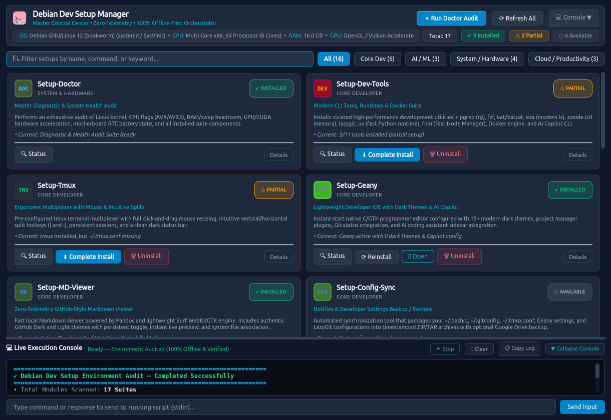

# Debian Dev Suite — Breathing New Life into Any Machine

*Debian Dev Suite* is a modular, ultra-lightweight, 100% open-source, secure, and privacy-focused developer environment toolkit built for Debian, MX Linux, antiX, Ubuntu, Linux Mint, Devuan, and all Debian-derived Linux distributions.

Designed to turn any machine—from ultra-resource-constrained legacy hardware (such as dual-core laptops with 2GB–3GB RAM) to modern multi-core workstations with dedicated GPUs—into a blisteringly fast, distraction-free development environment without the bloat of heavy desktop software.

---

## 💡 The Philosophy: Why Bloatware Must Go

In the modern software landscape, developers are frequently told they need a \$2,000 laptop with 32 GB of RAM just to run an editor, a couple of background daemons, a local database, and a web browser. Heavy Electron wrappers, telemetry trackers running in the background, and bloated desktop environments quietly consume gigabytes of memory before you even write a single line of code.

**Debian Dev Suite challenges this trend.** We believe that:

1. **Every computer has immense value**: Older laptops and budget machines can remain lightning-fast and productive when paired with clean, efficient tools.
2. **Your development environment belongs to you**: Zero telemetry, zero cloud dependencies, and zero background analytics tracking your work habits.
3. **Simplicity is the ultimate superpower**: Fast terminal multiplexing, lightweight editors, and native system utilities keep your focus entirely on creating great software.

At idle, the foundational suite consumes virtually **0–50 MB of RAM**, leaving all your system resources free for your compilers, test suites, and application runtimes.

---

## 🖥️ Master 1-Click GUI Manager (`./manager.sh`)

You do not need to memorize dozens of arcane terminal commands to set up your environment. Debian Dev Suite features a modern graphical control center that puts everything at your fingertips:

<p align="center">
  
</p>

* **Visual Module Inspection**: See the exact status of all 18 modular components at a single glance.
* **1-Click Installation & Clean Uninstallation**: Toggle any tool suite on or off with a single click.
* **Live Embedded Terminal Stream**: Watch every package installation, script configuration, and environment setup stream in real-time in an integrated terminal window.
* **Component Diagnostics**: Run isolated health checks on individual modules whenever you need troubleshooting.

To launch the master control center, simply run:

```bash
./manager.sh
```

---

## 🩺 The Built-In System Doctor (`./doctor.sh`)

Before configuring advanced toolchains or AI inference engines, it helps to know exactly what your hardware supports. Debian Dev Suite includes **System Doctor**, an automated diagnostic tool that performs an exhaustive audit of your system in seconds:

* **CPU Vector Capabilities**: Audits vector instruction support including AVX, AVX2, and AVX-512 to select the optimal binaries.
* **Memory & Storage Health**: Evaluates available RAM, swap space, and disk partitions.
* **Graphics & Driver Verification**: Identifies whether you are running Intel, AMD, or NVIDIA drivers and optimizes rendering profiles.
* **Hardware RTC Integrity**: Checks CMOS battery integrity and network time synchronization to prevent build timestamp skew.

Run the diagnostic suite anytime with:

```bash
chmod +x doctor.sh
./doctor.sh
```

---

## 🧰 A Tour of the 18 Curated Modular Tool Suites

Debian Dev Suite organizes its features into 18 independent, self-contained modules that you can pick and choose according to your exact needs:

### 1. Private Local AI & Offline Intelligence
* **Offline AI Inference (`Setup-LLAMA-CPP`)**: Run local Large Language Models (such as Llama, Mistral, and DeepSeek) directly on your CPU or GPU without paying for expensive cloud subscriptions.
* **Legacy Hardware AI (`Setup-LLAMA-CPP-LEGACY`)**: Specially optimized builds for older CPUs lacking AVX instructions, enabling local AI experimentation even on vintage laptops.
* **Private Web Chat Interface (`Setup-Libre-Chat`)**: A ChatGPT-style local web interface connected directly to your offline models. Your conversations never leave your local network.

### 2. Ergonomic Developer Workflows
* **Terminal Multiplexer (`Setup-Tmux`)**: Pre-configured tmux setup featuring mouse scrolling, intuitive split-pane navigation, and persistent sessions so you never lose your workspace.
* **Core Developer Runtimes (`Setup-Dev-Tools`)**: One-command provisioning for essential compilers, Git, Docker, Python virtual environments, Node.js, and GitHub Copilot CLI.
* **Distraction-Free Code Editor (`Setup-Geany`)**: Lightweight GTK code editor and IDE bundled with dark syntax themes, code folding, and zero startup lag.
* **Instant Markdown Previewer (`Setup-MD-Viewer`)**: Minimalist WebKitGTK-based Markdown previewer using Pandoc for reading documentation without opening a memory-hungry web browser.

### 3. Cloud Streaming & Offline Backup
* **Streaming Cloud Drive (`Setup-GDrive`)**: Mounts Google Drive as a local streaming file system using rclone FUSE. Access cloud files on-demand without duplicating gigabytes of data locally.
* **Offline Configuration Sync (`Setup-Config-Sync`)**: Back up your shell configurations, editor settings, and SSH keys to an encrypted USB flash drive or private cloud storage with a single command.

### 4. Privacy & Local Infrastructure
* **Private Localhost Git Forge (`Setup-Local-GitHub`)**: Runs Forgejo on your local machine (`127.0.0.1`), providing a private GitHub-like web portal for personal projects with zero third-party exposure.
* **Hardened Virtual Environments (`Setup-Virtual-Box`)**: Fully automated VirtualBox setup with host extensions and guest additions for testing isolated Linux and Windows virtual machines.

### 5. Hardware Control & Everyday Comfort
* **Display Brightness & Color Controller (`Setup-Brightness`)**: Standalone desktop GUI for software gamma and hardware backlight control, easing eye strain during late-night coding sessions.
* **Battery & Deep Sleep Optimization (`Setup-Deep-Sleep`)**: Tunes Linux kernel power parameters and enforces S3 deep sleep, extending laptop battery life and eliminating sleep battery drain.
* **Network & RTC Time Synchronization (`Setup-Sync-Time`)**: Reliable network time daemon keeping your system clock accurate.
* **Phonetic Hindi & Hinglish Typing (`Setup-Hinglish`)**: 100% offline ITRANS-based typing engine with per-window isolation, making bilingual documentation effortless.
* **Obsidian Dark Glass System Monitor (`Setup-Detailed-Conkey`)**: An elegant, semi-transparent desktop overlay displaying CPU temperatures, RAM usage, network bandwidth, and disk I/O in real time.

---

## 👥 Who Is Debian Dev Suite For?

* **Students & Learners**: Turn an affordable, older laptop into a full-featured programming lab without breaking the bank.
* **Minimalist & Privacy Enthusiasts**: Developers who value clean software, fast boot times, and total freedom from telemetry and commercial tracking.
* **Open-Source Contributors**: Anyone working on Linux, embedded systems, web applications, or Python scripts who wants a rock-solid, distraction-free environment.
* **Power Users on Modern Workstations**: Engineers who want maximum computing power channeled directly to their builds rather than wasted on desktop vanity animations.

---

## 🚀 Getting Started

Debian Dev Suite is 100% free and open-source under the MIT License. All scripts are completely transparent and human-readable, so you know exactly what is happening on your system at every step.

Explore the source code, inspect individual module scripts, and download the suite directly on GitHub:

👉 **[Explore Debian Dev Suite on GitHub](https://github.com/EG1DOTIN/debian-dev-suite)**
