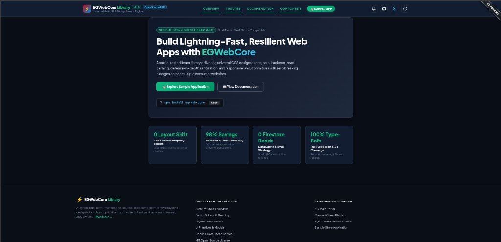

# EG-Web-Core — The Foundational React Engine for Modern Web Portals

*EG-Web-Core* is the open-source foundational React 18 component library, design token engine, and headless custom hooks system powering all modern applications across the EG1 ecosystem—including [eg1.in](https://eg1.in), [mchess.eg1.in](https://mchess.eg1.in), and [av.eg1.in](https://av.eg1.in).

It delivers accessible UI primitives, responsive layout shells, zero-read client state caching, hardened 3-tier administrative authentication, and unified dark and light theme engines—all without external CSS framework bloat.

---

## 💡 The Problem: Why Another Component Library?

When developers build modern web applications, they are often forced to choose between two extremes:

1. **Heavy CSS Frameworks with Runtime Overhead**: Libraries that inject hundreds of kilobytes of utility classes or JavaScript-in-CSS dependencies, degrading initial page load speeds and complicating long-term maintenance.
2. **Duplicated Code Across Projects**: Copying and pasting navigation bars, authentication routines, analytics collectors, and modals from one repository to another, causing divergent bug fixes and inconsistent user experiences.

**EG-Web-Core was created to solve both problems.** It provides a single, unified source of truth for design tokens, user interface components, and essential client-side services. It is strictly **website-agnostic** with clean, neutral defaults—meaning any consumer application can adopt it, pass custom props, and immediately render a cohesive, brand-aligned experience.

---

## 🎨 Zero-Dependency Theming & Design Tokens

  

EG-Web-Core eliminates the need for heavyweight styling dependencies. Instead, it harnesses standard browser **CSS Custom Properties** (`--eg-*`) to drive every visual dimension:

* **Fluid Typography & Spacing**: Uses modern CSS `clamp()` and relative units so text and layouts adapt smoothly to screens of all sizes—from compact mobile phones to ultra-wide desktop monitors.
* **Seamless Dark & Light Modes**: Instant theme transitions between bright, high-contrast light surfaces and deep obsidian dark canvases without flash of unstyled content.
* **Modern Glassmorphic Aesthetics**: Semi-transparent card backdrops, subtle border gradients, and hardware-accelerated micro-interactions (150–250ms ease) that feel crisp and responsive.

---

## 🔒 Hardened 3-Tier Security Architecture

Security is baked directly into the core rather than treated as an afterthought. For web portals requiring administrative management, EG-Web-Core incorporates an enterprise-grade, client-side three-tier security system:

1. **Tier 1: Google OAuth Identity Verification**: Restricts access exclusively to authorized email addresses configured via environment variables.
2. **Tier 2: 16-Digit Salted PBKDF2 PIN Challenge**: A secondary PIN verification providing $10^{16}$ possible combinations, computed directly inside the user's browser using the native Web Crypto API.
3. **Tier 3: Automated Lockout Defense**: Protects administrative endpoints against automated brute-force attacks by triggering an automatic 24-hour lockout after three consecutive incorrect attempts.
4. **DOMPurify Sanitization**: All dynamic Markdown and user-provided HTML strings pass through strict sanitization routines to eliminate cross-site scripting (XSS) vectors.

---

## ⚡ High-Efficiency Cloud Quota & Caching Patterns

Building scalable web applications should not result in runaway cloud hosting bills or sluggish network latency. EG-Web-Core introduces two high-efficiency client service patterns:

* **Zero-Read `DataCache` Service**: Static catalog databases, blog indices, and application markdown files are fetched once, validated, and stored in client-side `localStorage` with automated TTL management. When combined with build-time GitHub release synchronization, web portals load in **0ms** without triggering expensive Firestore read quotas.
* **50-Record Batched Bucket Telemetry**: Rather than firing a cloud write on every single page view, the `useVisitorTracker` hook collects anonymous, non-invasive visitor sessions into batched buckets of 50 records. This reduces cloud database write operations by **98%**, saving bandwidth while strictly respecting user privacy via the built-in `<ConsentBanner />`.

---

## 🧩 Reusable Layouts & Domain Feature Modules

EG-Web-Core is packed with pre-built, accessible components ready for production:

* **Universal Header & Navigation**: Responsive header with desktop pill menus, mobile slide-out drawer, theme switchers, notification bells, and cache-clearing shortcuts.
* **Dynamic Footer**: Modular footer providing quick access to platform policies, about pages, social links, and live version badges.
* **Markdown Viewer & Blog Engine**: Instant rendering of technical Markdown articles with syntax highlighting, deep linkable section headings, and estimated reading times.
* **Interactive Domain Modules**: Includes interactive PGN chess game viewers (powered by `chess.js`), math-based CAPTCHA contact forms, product showcase grids, and desktop application simulators.

---

## 👥 Who Is EG-Web-Core For?

* **Web Engineers & Front-End Architects**: Developers seeking a battle-tested, modular component library that provides complete architectural control without framework lock-in.
* **Multi-Project Ecosystems**: Teams maintaining multiple consumer portals who want unified brand consistency and DRY (Don't Repeat Yourself) design standards.
* **Privacy-Minded Developers**: Projects that require transparent, GDPR-compliant visitor analytics, zero third-party trackers, and strict XSS sanitization out of the box.

---

## 🌐 Explore the Live Showcase & Documentation

Experience the components, design tokens, and interactive documentation live in action:

👉 **[Launch EG-Web-Core Showcase Portal](https://web-core.eg1.in/)**  
👉 **[View Source Code on GitHub](https://github.com/EG1DOTIN/eg-web-core)**
