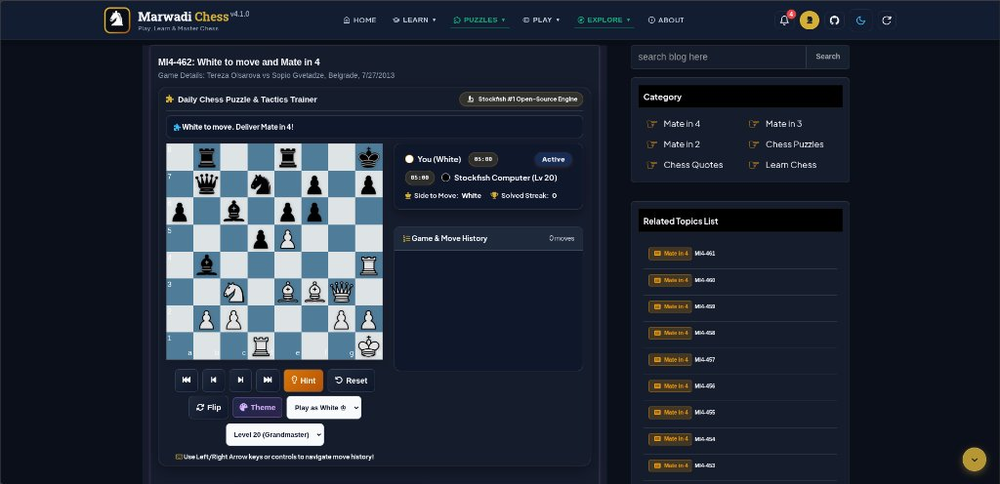

# Marwadi Chess — An Elegant, Distraction-Free Sanctuary for the Royal Game

*Marwadi Chess* (`mchess.eg1.in`) is an open-source, modern web application dedicated to playing, studying, and mastering the royal game of chess. Built with React 18, TypeScript, Vite, and `chess.js`, it is powered by the shared `eg-web-core` design system.

Whether you want to play a quick online game with a friend, challenge an intelligent computer engine, solve tactical puzzles, or study legendary historic matches, Marwadi Chess brings everything together in an uncluttered, ad-free environment.

---

## ♟️ The Spirit of Marwadi Chess: Pure Focus, Zero Distractions

  

Chess is one of humanity’s oldest and most profound intellectual pursuits—a test of strategy, spatial visualization, patience, and mental endurance. Yet in today's digital chess landscape, players are constantly bombarded with intrusive advertisements, flashing upgrade banners, subscription paywalls, and heavy browser bloat.

**Marwadi Chess was created to restore the purity of the game.**

* **100% Free & Open-Source**: No paywalled puzzle limits, no VIP tiers, and no subscriptions.
* **Zero Intrusive Ads or Tracking**: Play in peace without noisy video ads or tracking cookies disrupting your concentration.
* **Staunton Dark Canvas Design**: A custom-crafted visual aesthetic featuring deep obsidian tones (`#0a0e17`) and warm gold accents (`#d4af37`), designed to be easy on the eyes during long tactical battles.
* **Instant Browser Play**: No app downloads or account creation required to start playing; works seamlessly on smartphones, tablets, and desktop computers.

---

## 🌟 Comprehensive Features for Every Chess Enthusiast

Marwadi Chess offers a full 15-page platform covering every dimension of chess training and entertainment:

### 1. Real-Time Online Multiplayer (`Play Online`)
Create private game rooms with custom time controls or join open rooms to challenge fellow players across the globe. Powered by real-time synchronization, clocks and moves update instantly with full legal move validation.

### 2. Intelligent AI Computer Opponent (`Play Computer`)
Want to practice your openings or test a tricky endgame? Play against the built-in computer engine. Customize the AI's difficulty level, flip the board to practice both perspectives, and undo moves to explore alternate tactical lines.

### 3. Daily Tactical Puzzles & Training (`Daily Puzzles & Train`)

Tactics win games. Sharpen your pattern recognition every day with interactive tactical puzzles. If you get stuck, request step-by-step hints or explore variations in the freeform board analysis studio.

### 4. Interactive Opening Traps Catalog (`Chess Traps`)
Avoid painful early blunders and catch unsuspecting opponents! Study famous opening traps—including the **Fried Liver Attack**, **Scholar's Mate**, **Blackburne Shilling Gambit**, **Legal's Trap**, and the **Elephant Trap**—with step-by-step interactive board demonstrations explaining the mistakes and refutations.

### 5. Master PGN Games Database (`PGN Games & My Games`)
Step into the minds of the legends. Browse a curated database of master games from historical champions like Bobby Fischer, Garry Kasparov, and Mikhail Tal. Replay moves step-by-step, inspect critical turning points, and export your own played games in standard PGN notation.

### 6. Live Grandmaster Tournament Broadcasts (`Watch Live`)
Stay connected to the pinnacle of competitive chess. Watch live move broadcasts from major international Grandmaster tournaments and World Championship matches directly inside the app.

### 7. Inspiring Chess Wisdom & Tactical Blog (`Blog & Quotes`)
Immerse yourself in inspiring quotes from world champions, insightful articles exploring the rich cultural heritage and history of chess, and Mate-in-N tactical problem breakdowns.

---

## 📱 Mobile-First, Touch-Friendly Ergonomics

Marwadi Chess was engineered from the ground up to provide a silky-smooth experience on touchscreens:

* **Generous 44×44px Touch Targets**: Effortlessly tap and drag pieces without accidental misclicks.
* **Fluid Layouts**: The chessboard automatically scales to fit your screen size while keeping timers and captured pieces cleanly visible.
* **Ultra-Fast Performance**: Built on modern Vite and React 18, pages transition instantaneously with sub-millisecond route resolution.

---

## 👥 Who Is Marwadi Chess For?

* **Casual Players & Friends**: Looking for an instant, hassle-free way to create a private room and play a friendly game of chess online.
* **Students & Beginners**: Learners eager to understand the fundamental rules, avoid opening traps, and solve interactive daily puzzles.
* **Competitive Club Players**: Serious tacticians looking for a lightweight board to analyze PGNs, review master games, and practice blindfold coordinates.
* **Open-Source Advocates**: Enthusiasts who believe chess software should be community-driven, transparent, and accessible to everyone.

---

## 🚀 Play Today

Step onto the board, plan your strategy, and make your move:

👉 **[Launch Marwadi Chess Platform](https://mchess.eg1.in/)**  
👉 **[Contribute on GitHub](https://github.com/EG1DOTIN/mchess.eg1.in)**
