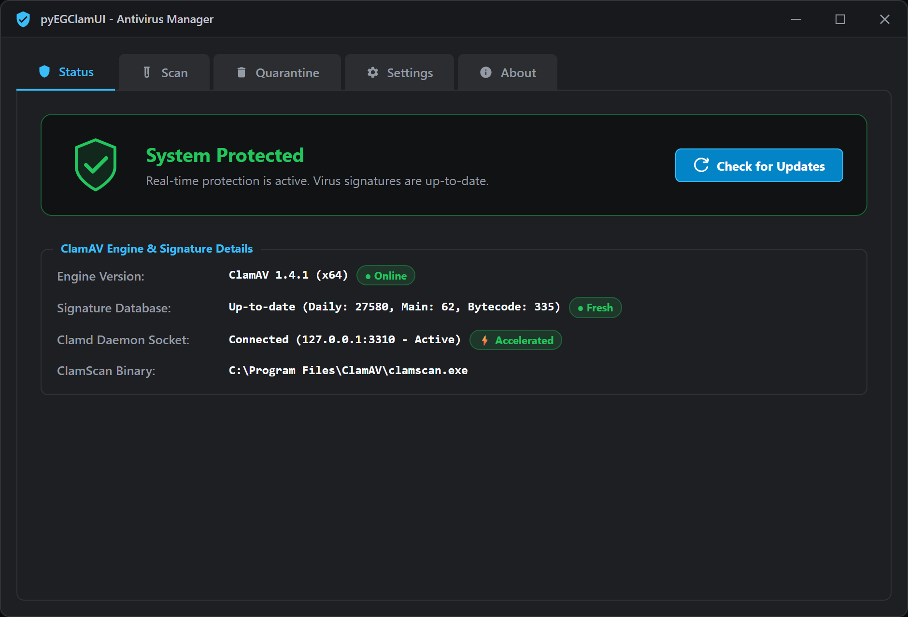
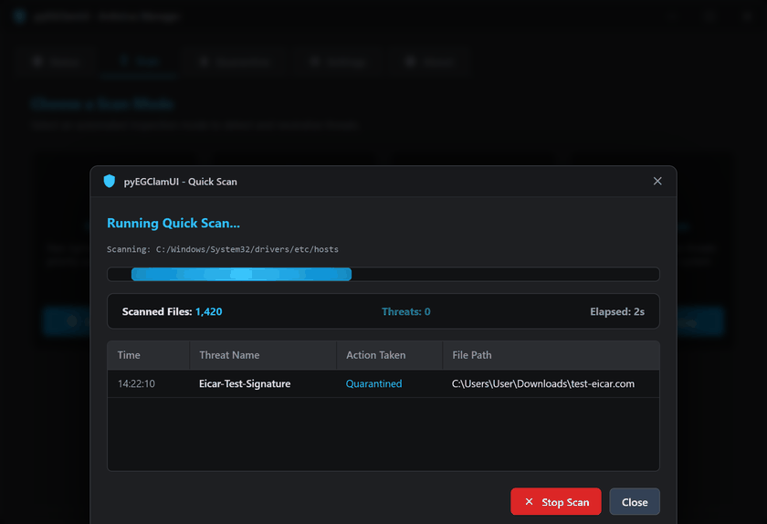

# pyEGClamUI — Modern Desktop Antivirus Protection for Everyone

*pyEGClamUI* is an open-source, cross-platform desktop graphical user interface (GUI) built for the battle-tested **ClamAV** antivirus engine. Developed with modern Python and Qt (PySide6), it transforms a command-line security tool into a friendly, intuitive desktop application.

Available with dedicated documentation, live release synchronization, and an interactive in-browser simulator at [av.eg1.in](https://av.eg1.in).

---

## 🛡️ Why Desktop Antivirus Protection Still Matters

There is a long-standing myth that open-source operating systems like Linux are entirely immune to viruses and security risks. While Linux security permissions and sandboxing provide robust defense, the modern threat environment has evolved:

1. **Cross-Platform File Sharing**: We routinely receive email attachments, zip archives, and USB drives from friends, colleagues, and external clients using various operating systems. Scanning files before opening or forwarding them prevents cross-platform malware transmission.
2. **Web Downloads & Browser Scripts**: Malicious shell scripts, phishing documents, macros, and poisoned media files can target user-level directories without requiring root access.
3. **ClamAV's Power vs. Usability Barrier**: ClamAV is trusted worldwide by enterprise mail gateways and web servers, but running commands like `clamscan -r -i /home/user/Downloads` in the terminal can be intimidating for casual or non-technical users.

**pyEGClamUI bridges this gap.** It gives you the full, uncompromised scanning power of ClamAV inside a modern, clean graphical interface that anyone can use with confidence.

---

## ⚡ Key Features & Everyday Usability

  

pyEGClamUI combines deep security controls with an accessible, distraction-free desktop experience:

* **1-Click Scanning**: Choose between a Quick Home Scan, Full System Scan, or Custom Folder Scan with a single click.
* **Drag-and-Drop File Scanning**: Drag any downloaded file, zip archive, or executable directly into the pyEGClamUI window to inspect it immediately.

  

* **Automated Virus Definition Updates**: Seamlessly triggers `freshclam` to keep your threat database up to the minute, ensuring protection against emerging zero-day payloads.
* **Secure Quarantine Vault**: Detected threats are safely isolated in a sandboxed quarantine directory where they cannot execute. Inspect threat names, review file paths, safely restore false positives, or permanently shred malicious files.
* **Scheduled Background Scans**: Set up recurring scans (daily or weekly) during your off-hours so your computer remains protected without interrupting your work.
* **System Tray Integration & Native Alerts**: Minimize pyEGClamUI to your desktop system tray. It sits quietly in the background and surfaces clean native desktop notifications only when your attention is required.
* **Detailed Scan Logs & Export**: Review chronological scan logs with timestamps, files scanned, detection rates, and duration.

---

## 🔒 100% Privacy & Zero Cloud Surveillance

Unlike commercial proprietary antivirus suites that monetize your activity by uploading browsing telemetry, file metadata, and system identifiers to remote corporate servers:

* **Zero Telemetry**: pyEGClamUI collects **0 bytes** of personal information.
* **Local Processing**: All scanning and file analysis happen strictly on your local hardware.
* **Open Source & Auditable**: Every line of Python and Qt code is open-source under the GNU GPL, allowing anyone to verify its security and integrity.

---

## 🖥️ Interactive Web Simulator at `av.eg1.in`

Curious about how pyEGClamUI works before downloading it? Visit the official portal at [av.eg1.in](https://av.eg1.in/) to try the **Interactive Qt Desktop Simulator** directly inside your web browser. 

The simulator lets you toggle security statuses (Secure, Warning, Critical), trigger mock scans, and experience the interface firsthand without installing any software.

---

## 📦 Download & Installation

pyEGClamUI is available across major Linux distributions and platforms:

* **Debian & Ubuntu**: Native `.deb` packages with automatic dependency resolution.
* **Fedora & openSUSE**: Standalone `.rpm` packages.
* **Universal AppImage**: 1-click portable executable that runs on any modern Linux distribution without installation.
* **Python PIP / Source**: Installable in any Python virtual environment with `pip install .`.

👉 **[Visit the pyEGClamUI Portal](https://av.eg1.in/)**  
👉 **[Download Releases on GitHub](https://github.com/EG1DOTIN/pyEGClamUI)**
