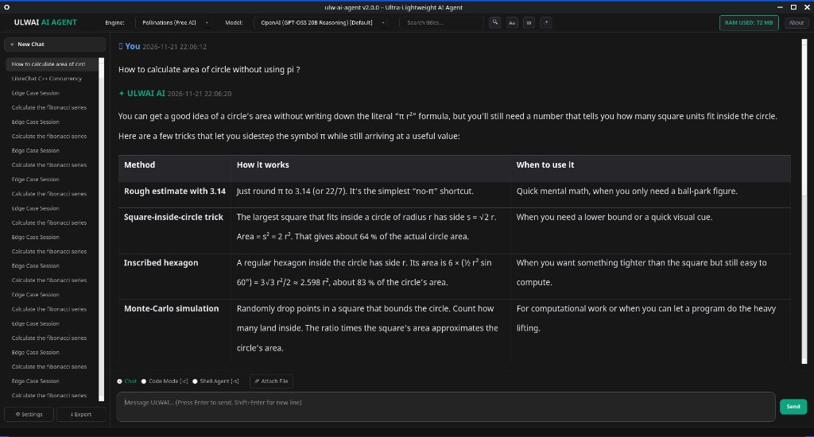

# ULWAI — Ultra-Lightweight Native AI Agent for Desktop & Terminal

  

*ULWAI* is a high-performance, native C++20 desktop and terminal AI assistant. It combines an intuitive desktop chat experience with a blisteringly fast terminal interface—engineered with zero heavy runtimes (no Electron, no webview bloat, no Node.js, and no Python overhead) and sub-second startup times.

While modern AI desktop clients routinely consume 500 MB to 1 GB of memory just to show a chat window, **ULWAI operates strictly under 100 MB of RAM** (typically ~40–65 MB in active GUI mode) while delivering streaming conversations, multi-engine intelligence, and safe shell automation.

---

## ⚡ The Big Idea: Why Does an AI Chat App Need 1 GB of RAM?

In the current wave of generative artificial intelligence, intelligent desktop assistants have become indispensable daily companions for writing, coding, brainstorming, and system administration. 

However, almost every popular AI desktop app today is built using Electron or embedded webviews. Under the hood, this means each app is running an entire instance of the Chromium browser alongside Node.js. The consequence?
* Sluggish startup times that take seconds to initialize.
* Continuous memory hogs consuming **400 MB to 800+ MB of RAM** at idle.
* Heavy battery drain and spinning laptop fans on portable devices.
* Inability to run smoothly on older laptops or budget hardware.

**ULWAI reimagines the desktop AI experience from first principles.** By compiling directly to native machine code in modern C++20, ULWAI delivers instant responsiveness and mechanical efficiency. It opens in the blink of an eye, uses a tiny fraction of your system resources, and leaves all your memory available for your actual work.

---

## 🖥️ Dual Personality: Modern Desktop GUI & Blazing Terminal CLI

ULWAI gives you the best of both worlds, adapting seamlessly to however you prefer to work:

### 1. Modern Desktop UI Mode
For users who enjoy a visual workspace, ULWAI features a refined, dark ChatGPT-inspired desktop interface:
* **Real-Time Token Streaming**: Watch responses flow smoothly character-by-character without stutter or UI freezing.
* **Syntax-Highlighted Code Blocks**: Automatically formats code in Python, C++, JavaScript, Rust, Bash, and dozens of other languages with convenient 1-click clipboard copy.
* **Smart History & Filtering**: Collapsible sidebar with instant conversation search and advanced filters (`[Aa]` Case-Sensitive, `[W]` Whole Word, and `[.*]` Regular Expressions).
* **Multi-Turn Memory & Attachments**: Attach reference files and hold extended context-aware conversations.
* **$O(1)$ Incremental Rendering**: Renders new conversation turns instantaneously without sluggish full-document DOM re-parsing.

### 2. Powerful Terminal / CLI Mode
For developers, sysadmins, and terminal enthusiasts, ULWAI can be invoked directly from your command line:
* **One-Shot Queries**: Ask quick questions directly from bash or zsh:  
  `ulwai "explain the difference between mutex and semaphore"`
* **Code Mode (`-c`)**: Generate clean, ready-to-run code snippets directly to standard output.
* **Interactive REPL Shell (`--cli`)**: Jump into an interactive terminal conversation session.
* **Headless Binary (`ulwai-cli`)**: A dedicated lightweight CLI binary that compiles with zero Qt or GUI dependencies—operating under **15 MB of RAM** with a ~700 KB binary size, perfect for headless cloud servers and SSH sessions.

---

## 🔌 7 AI Backends: Free Cloud, Private Offline, & Leading Providers

ULWAI is strictly provider-agnostic. You are never locked into a single ecosystem, and you can switch between 7 powerful backends at any time:

1. **Pollinations.ai (Default Free Cloud AI)**:  
   Get started immediately with **zero configuration and zero API keys**. Enjoy fast, high-quality generative AI text and code generation completely free of charge.
2. **DuckDuckGo Instant Answers**:  
   Fetch fast, factual definitions, math calculations, and unit conversions without requiring any account or key.
3. **Ollama & llama.cpp (100% Private Offline Inference)**:  
   Connect directly to your local Ollama instance (`localhost:11434`) or local llama.cpp server. Chat with open-source models like Llama 3, Mistral, Qwen, and DeepSeek with **100% offline privacy**—not a single byte of your data ever leaves your computer!
4. **OpenAI & Compatible APIs**:  
   Full support for official OpenAI models (`gpt-4o`, `gpt-4o-mini`) as well as any OpenAI-compatible API endpoint (such as LM Studio, vLLM, Groq, and LocalAI).
5. **OpenRouter**:  
   Access hundreds of commercial and open-source models through a single aggregator key.
6. **xAI Grok**:  
   Native integration with xAI Grok APIs (`grok-beta`, `grok-2`).
7. **Hugging Face**:  
   Direct connectivity to Hugging Face Serverless Inference endpoints.

---

## 🛡️ Safe Shell Agent Mode: Intelligent Automation with User Consent

Need help troubleshooting an unfamiliar Linux error or writing a complex ffmpeg command? ULWAI includes a **Shell Agent Mode (`-s`)**:

1. You describe the task in natural language.
2. ULWAI formulates the precise shell command needed.
3. **Interactive Confirmation Safety**: ULWAI will **never** execute an operating system command without explicit user consent. In the GUI, a clean dialog prompts you for approval; in the terminal, it asks for a clear `[y/N]` confirmation.
4. Once approved, ULWAI executes the command, captures the output, and feeds it back into the conversation to explain the result.

---

## 🔒 Privacy by Design & Zero Telemetry

* **Direct Encrypted Connections**: All API requests travel directly from your computer to the AI endpoint via HTTPS. There are zero middleman proxy servers, zero data brokers, and zero telemetry beacons.
* **Local History Storage**: Conversations and settings are stored locally in standard user configuration paths (`~/.config/ulwai` on Linux, `%APPDATA%\ulwai` on Windows).
* **100% Open-Source**: Licensed under the MIT License, every line of C++20 code is transparent, auditable, and community-driven.

---

## 👥 Who Is ULWAI For?

* **Resource-Conscious Developers**: Programmers who want an AI copilot that does not choke their machine or compete with compilers and IDEs for RAM.
* **Privacy Enthusiasts**: Anyone running local LLMs through Ollama who wants a private, local desktop interface with zero internet dependency.
* **Students & General Users**: People who want a free, instant AI companion powered by Pollinations with no credit card or complex setup required.
* **DevOps & Sysadmins**: Engineers managing headless servers who need a rapid terminal CLI assistant that operates within megabytes of memory.

---

## 🚀 Get Started with ULWAI

ULWAI is cross-platform and runs natively on Linux, Windows, and macOS. Ready-to-run packages including Linux AppImages and Windows installers are available on GitHub:

👉 **[Download ULWAI on GitHub](https://github.com/EG1DOTIN/ulwai)**  
👉 **[Read the Full Documentation & Architecture](https://github.com/EG1DOTIN/ulwai/tree/main/docs)**
